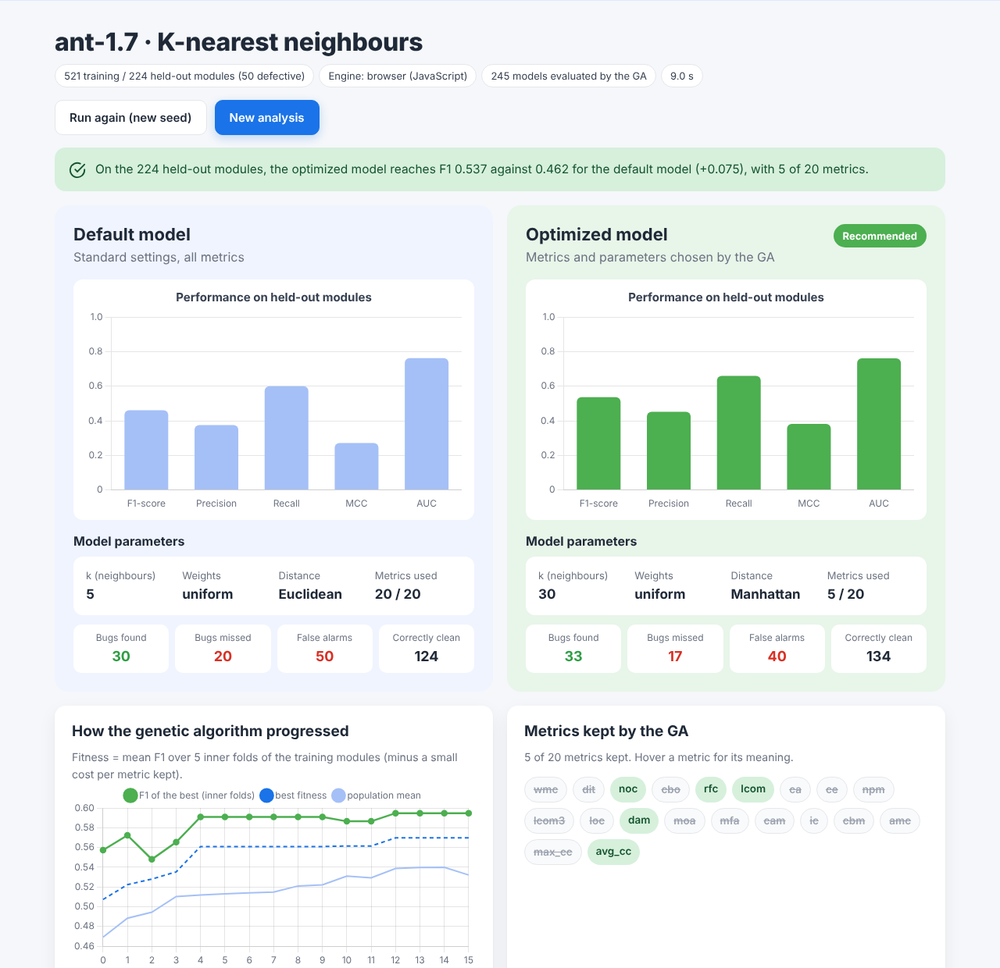

# BugPredictor

**Predict which classes of a software project are likely to contain bugs**, so that code review and testing go where they matter. Machine learning on code metrics, a genetic algorithm that selects the metrics and tunes the model, and an evaluation **without data leakage**.

**[Live demo](https://yassine-portfolio-virid.vercel.app/demos/bugpredictor/)** (runs in your browser) · [Version française](README_FR.md) · final-year project (PFE), rewritten in 2026



## What it does

1. **Choose the data**: one of 11 open-source Java projects from the PROMISE repository, or your own CSV/ARFF file (one row per class or module, numeric metrics, a bug column).
2. **Choose a model**: k-nearest neighbours, SVM (RBF kernel), logistic regression, Gaussian naive Bayes or random forest.
3. **The genetic algorithm** searches, generation after generation, which of the code metrics to keep and how to set the model's hyperparameters.
4. **Honest comparison**: the default and the optimised models are both scored on 30 % of the classes kept aside, which the GA never saw. The verdict says plainly when the GA did *not* help.
5. **Classes to review first**: every class gets a risk score from a model that did not see it during training (out-of-fold predictions), with an effort-aware score (how many buggy classes you find by reading 20 % of the code). The ranking can be downloaded as CSV.

The **Research** page of the app summarises the study below.

## Run it

```bash
git clone https://github.com/yassinedache/bugpredictor.git
cd bugpredictor
python -m venv .venv && source .venv/bin/activate      # Windows: .venv\Scripts\activate
pip install -r requirements.txt

uvicorn app.server:app          # web app + Python engine on http://127.0.0.1:8000
pytest                          # 21 tests (with Node.js installed, they include the JavaScript parity tests)
python experiments/run_all.py   # all experiments, about 1 h 30 on 2 cores
```

With Docker: `docker build -t bugpredictor . && docker run -p 8000:8000 bugpredictor`.

The `web/` folder is also a **self-contained static site**: opened without the Python server (for example on Vercel, as in the live demo), it runs a JavaScript port of the whole pipeline (`web/js/ml.js`), all five models included, on a pool of Web Workers so that the GA evaluates its individuals in parallel. `tests/test_js_parity.py` checks the port against scikit-learn: k-NN and naive Bayes give the same probabilities (to 1e-9) and logistic regression the same optimum (1e-6); the SVM uses libsvm's SMO solver and its decision values agree within the solver's tolerance (1e-3); a tree of the random forest is identical to scikit-learn's when no two splits tie, and forests reach the same AUC (±0.02); metrics and file parsing are identical.

As a library:

```python
from bugpredictor import load_promise, cross_validate, GeneticOptimizer
from bugpredictor.analysis import analyze

ds = load_promise("ant-1.7")                       # or bugpredictor.load("my_project.csv")
print(cross_validate(ds, "rf", repeats=5)["mean"])  # F1, MCC, AUC, Recall@20%LOC...
report = analyze(ds, model="knn", generations=15)   # what the web app shows
```

## How it works

**Data.** The [PROMISE](https://doi.org/10.1145/1868328.1868342) defect datasets describe each Java class by 20 metrics: the Chidamber & Kemerer suite (WMC, DIT, NOC, CBO, RFC, LCOM), Martin's coupling metrics (Ca, Ce), QMOOD metrics (DAM, MOA, MFA, CAM, NPM), LCOM3, IC, CBM, AMC, cyclomatic complexity and lines of code. The target is the number of bugs linked to the class; *defective* means at least one. `data/promise/` holds all 41 releases; the experiments use, for each of the 11 projects, the latest release whose share of defective classes lies between 5 % and 70 % (jedit-4.3 has 2 %, xalan-2.7 99 %: such releases make the task degenerate).

**Pipeline, fitted on training rows only.** Median imputation → `log(1 + x)` for the non-negative metrics (they are very skewed) → standardisation → **SMOTE** (synthetic minority over-sampling, written with NumPy in `bugpredictor/smote.py`) → classifier. Every statistic comes from the training part of the fold, never from the rows being predicted.

**Genetic algorithm** (`bugpredictor/ga.py`, written from scratch):
- *individual*: a bit per metric (kept or not) + one gene in [0, 1] per hyperparameter (k, weights and distance for k-NN; C and γ for the SVM; C for logistic regression...);
- *fitness*: mean F1 of a 5-fold cross-validation **on the training rows**, minus 0.005 per metric kept (simpler models win ties);
- population 20, up to 15 generations (stops after 6 without progress), tournament selection (size 3), uniform crossover (rate 0.8), bit-flip mutation (1/20 per bit) and Gaussian mutation of the hyperparameter genes, elitism (2), and a cache of already evaluated individuals;
- the default model with all metrics is part of the first population.

**Evaluation.** *Nested* cross-validation: 5 outer folds; on each outer training part the GA runs its own inner cross-validation, then the chosen model is scored on the outer test fold. Metrics: F1 of the defective class, MCC, ROC AUC, false-alarm rate and **Recall@20%LOC** (share of the defective classes found when inspecting classes by predicted risk per line until 20 % of the code is read).

## Results

All numbers below come from `python experiments/run_all.py`; the full tables are in [`results/results.md`](results/results.md).

### 1. The first version of the project leaked test data

The original notebooks (kept in [`research/original/`](research/original/)) standardised the data and applied SMOTE to the **whole dataset before cross-validation**. A synthetic class is an interpolation between a real class and one of its neighbours, so every test fold contained near-copies of the training rows, and a 1-nearest-neighbour model simply found them. This is why the first version reported F1 scores of up to 0.98 (above 0.93 on 6 of its 10 projects), with the GA mostly choosing k = 1.

Re-running both protocols on the same 11 releases:

| Mean F1 over 11 releases | SMOTE before the split (original) | SMOTE inside the training folds |
|---|---:|---:|
| 1-NN | 0.855 | 0.564 |
| 5-NN | 0.803 | 0.562 |
| k-NN + GA (original protocol vs nested CV) | **0.876** | **0.578** |


### 2. Default models

5 × 5-fold cross-validation, mean over the 11 releases:

| | k-NN | Logistic regression | Naive Bayes | SVM (RBF) | Random forest |
|---|---:|---:|---:|---:|---:|
| F1 | 0.568 | 0.588 | 0.583 | 0.588 | **0.603** |
| MCC | 0.371 | 0.404 | 0.392 | 0.408 | **0.441** |
| AUC | 0.774 | 0.799 | 0.786 | 0.796 | **0.820** |
| Recall@20%LOC | 0.444 | 0.464 | 0.372 | 0.464 | **0.469** |

The effort-aware scores deserve a warning: simply reviewing the **smallest classes first** finds 0.445 of the defective classes with the same 20 % of the code, about as many as the models. Removing SMOTE lowers the recall of every model (k-NN: 0.69 → 0.50) and the F1 of all of them except naive Bayes; the log transform matters most for naive Bayes (F1 0.505 → 0.581).

### 3. What the genetic algorithm really brings

| Model | F1 default | F1 with GA | GA better on | Metrics kept | GA's own estimate |
|---|---:|---:|---:|---:|---:|
| k-NN | 0.560 | 0.578 | 8 / 11 | 6.7 / 20 | 0.676 |
| SVM (RBF) | 0.584 | 0.574 | 5 / 11 | 6.2 / 20 | 0.670 |
| Logistic regression | 0.581 | 0.577 | 4 / 11 | 5.9 / 20 | 0.650 |

The default models are scored on the same 5 outer folds as the GA (one repetition), so their F1 differs slightly from section 2.

Evaluated honestly, the GA's gains in F1 are **small and depend on the dataset**: it helps k-NN a little and does not help the SVM or logistic regression on average. Its clearest benefit is a **much smaller model**, with about a third of the metrics. The last column is the F1 the GA *believed* it had reached on its own folds: about 0.1 above the real score. That gap is exactly what a non-nested protocol would have reported as a result.

The selected metrics are also **unstable**: no metric is kept in more than 41 % of the 165 GA runs (`rfc`, then `loc`, `dit`, `ce`, `cbm`, `cbo`). The CK metrics are strongly correlated with size, so many different subsets work about equally well.


| | |
|---|---|
|  |  |


### 4. Predicting a new release or a new project

Within-project cross-validation is optimistic about real use. Training on the **previous release** of the same project (cross-version), or on the **10 other projects** (cross-project):

| Mean F1 | Within (CV) | Previous release | Other projects |
|---|---:|---:|---:|
| k-NN | 0.568 | 0.501 | 0.450 |
| Logistic regression | 0.588 | 0.527 | 0.495 |
| Naive Bayes | 0.583 | **0.540** | **0.532** |
| SVM (RBF) | 0.588 | 0.498 | 0.492 |
| Random forest | **0.603** | 0.509 | 0.444 |

Naive Bayes, the simplest model, transfers best.

### Conclusions

- Data leakage was the main issue of the first version: once SMOTE is fitted inside the training folds, the realistic F1 on these projects is around 0.55–0.60 (AUC ≈ 0.8), not 0.9+.
- The genetic algorithm is worth it for **interpretability and model size** (≈ 6–7 metrics out of 20) more than for accuracy; its gains in F1 are within the variation between datasets.
- Effort matters: a ranking that ignores class size is no better than "read the small classes first".
- Model choice matters less than how the data is used: training on the previous release costs about 0.07 of F1, training on other projects about 0.1.

## Project structure

```
bugpredictor/        Python package
  data.py            CSV/ARFF loading, target detection, the PROMISE releases
  preprocessing.py   imputation, log transform, standardisation (fitted on training rows)
  smote.py           SMOTE with NumPy
  models.py          classifiers, default settings, hyperparameter ranges for the GA
  metrics.py         F1, MCC, AUC, Recall@20%LOC, smallest-first baseline
  evaluation.py      stratified folds, leakage-free CV, the original (leaky) protocol, transfer
  ga.py              the genetic algorithm
  analysis.py        the analysis shown by the web app
app/server.py        FastAPI: serves web/ and runs analyses with scikit-learn
web/                 the web app (HTML/CSS/JS) and its JavaScript engine (js/ml.js, js/worker.js)
data/promise/        41 PROMISE releases (11 projects)
experiments/         run_all.py (experiments), report.py (tables, figures, results.md)
results/             results.md, figures/, tables/, raw/
tests/               pytest suite, including the JavaScript parity test
tools/build_web.py   copies the benchmark data and the research summary into web/data
research/original/   the first version's notebooks and scripts (leaky protocol, kept for reference)
```

## API (Python engine)

| Method | Path | |
|---|---|---|
| GET | `/api/health` | status and available models |
| GET | `/api/datasets` | the 41 PROMISE releases |
| POST | `/api/upload` | upload a CSV/ARFF file (parsed as text, 10 MB max) |
| POST | `/api/analyze` | start an analysis: `{"dataset": "ant-1.7", "model": "svm", "generations": 15, "population": 20, "seed": 0}` |
| GET | `/api/jobs/{id}` | progress, GA history and result |
| GET | `/api/jobs/{id}/predictions.csv` | the full risk ranking |

Interactive documentation at `/docs`. The first version accepted uploaded *pickled* models; loading a pickle can run arbitrary code, so that endpoint is gone.

## References

- M. Jureczko, L. Madeyski, *Towards identifying software project clusters with regard to defect prediction*, PROMISE 2010 (the datasets). Copy used here: [hjx-zhans/promise-backup](https://github.com/hjx-zhans/promise-backup).
- S. R. Chidamber, C. F. Kemerer, *A metrics suite for object oriented design*, IEEE TSE, 1994.
- N. V. Chawla et al., *SMOTE: synthetic minority over-sampling technique*, JAIR, 2002.
- Y. Kamei et al., *A large-scale empirical study of just-in-time quality assurance*, IEEE TSE, 2013 (effort-aware evaluation).
- C. Tantithamthavorn, A. E. Hassan, K. Matsumoto, *The impact of class rebalancing techniques on the performance and interpretation of defect prediction models*, IEEE TSE, 2020.

## Author

Yassine Abderrezak Dache · [portfolio](https://yassine-portfolio-virid.vercel.app) · MIT licence
