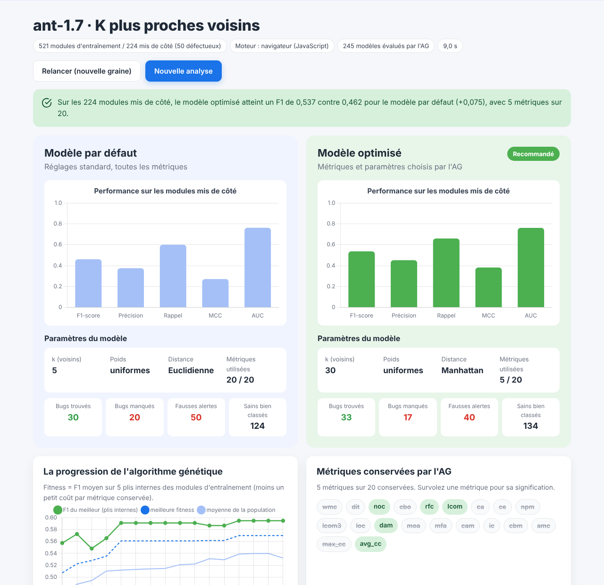
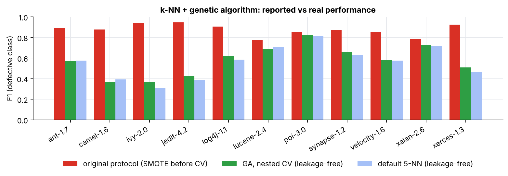
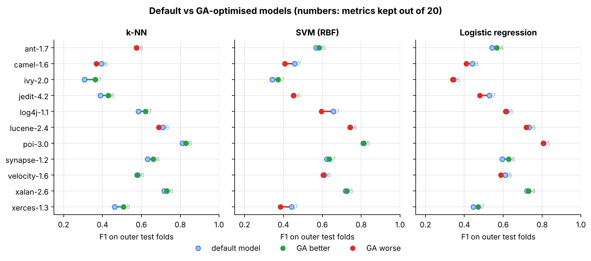
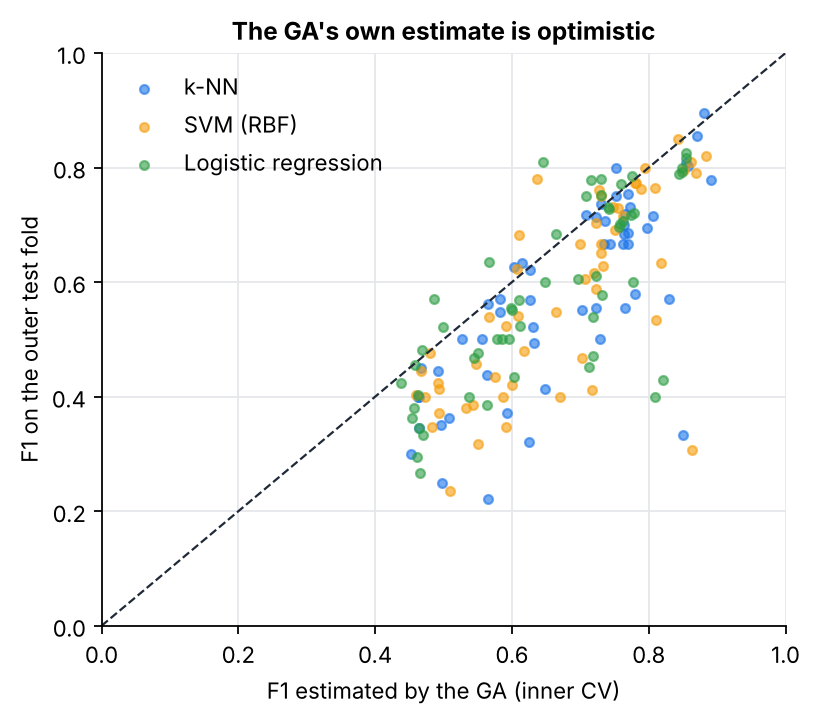
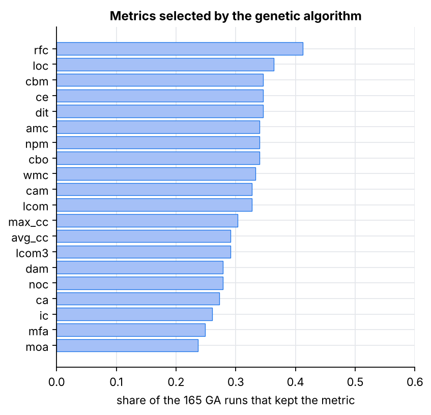
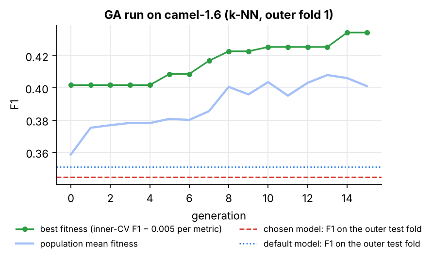

# BugPredictor

**Prédire quelles classes d'un projet logiciel risquent de contenir des bugs**, pour concentrer la relecture et les tests là où c'est utile. Apprentissage automatique sur des métriques de code, un algorithme génétique qui choisit les métriques et règle le modèle, et une évaluation **sans fuite de données**.

**[Démo en ligne](https://yassine-portfolio-virid.vercel.app/demos/bugpredictor/?lang=fr)** (s'exécute dans le navigateur) · [English version](README.md) · projet de fin d'études (PFE), réécrit en 2026



## Ce que fait l'outil

1. **Choisir les données** : l'un des 11 projets Java open source du dépôt PROMISE, ou votre propre fichier CSV/ARFF (une ligne par classe ou module, des métriques numériques, une colonne de bugs).
2. **Choisir un modèle** : k plus proches voisins, régression logistique, Bayes naïf gaussien, ainsi que SVM et forêt aléatoire avec le moteur Python.
3. **L'algorithme génétique** cherche, génération après génération, quelles métriques garder et comment régler les hyperparamètres du modèle.
4. **Comparaison honnête** : le modèle par défaut et le modèle optimisé sont évalués sur 30 % des classes mises de côté, que l'AG n'a jamais vues. Le verdict indique clairement quand l'AG n'a *pas* aidé.
5. **Classes à relire en priorité** : chaque classe reçoit un score de risque calculé par un modèle qui ne l'a pas vue à l'entraînement (prédictions hors-pli), avec un score tenant compte de l'effort (combien de classes boguées on trouve en lisant 20 % du code). Le classement se télécharge en CSV.

La page **Étude** de l'application résume l'étude ci-dessous.

## Lancer le projet

```bash
git clone https://github.com/yassinedache/bugpredictor.git
cd bugpredictor
python -m venv .venv && source .venv/bin/activate      # Windows : .venv\Scripts\activate
pip install -r requirements.txt

uvicorn app.server:app          # application web + moteur Python sur http://127.0.0.1:8000
pytest                          # 20 tests (Node.js lance aussi le test de parité JavaScript)
python experiments/run_all.py   # toutes les expériences, environ 1 h 30 sur 2 cœurs
```

Avec Docker : `docker build -t bugpredictor . && docker run -p 8000:8000 bugpredictor`.

Le dossier `web/` est aussi un **site statique autonome** : ouvert sans le serveur Python (par exemple sur Vercel, comme la démo en ligne), il exécute un portage JavaScript du pipeline (`web/js/ml.js`) dans un Web Worker. `tests/test_js_parity.py` vérifie que les modèles JavaScript donnent les mêmes probabilités que scikit-learn (k-NN et Bayes naïf à 1e-9 près, régression logistique à 1e-6 près), ainsi que les mêmes métriques et la même lecture des fichiers.

## Fonctionnement

**Données.** Les jeux de données [PROMISE](https://doi.org/10.1145/1868328.1868342) décrivent chaque classe Java par 20 métriques : la suite de Chidamber et Kemerer (WMC, DIT, NOC, CBO, RFC, LCOM), les couplages de Martin (Ca, Ce), des métriques QMOOD (DAM, MOA, MFA, CAM, NPM), LCOM3, IC, CBM, AMC, la complexité cyclomatique et le nombre de lignes. La cible est le nombre de bugs liés à la classe ; *défectueuse* signifie au moins un. `data/promise/` contient les 41 versions ; les expériences utilisent, pour chacun des 11 projets, la dernière version dont la part de classes défectueuses est comprise entre 5 % et 70 % (jedit-4.3 en a 2 %, xalan-2.7 99 % : la tâche y devient dégénérée).

**Pipeline, ajusté sur les seules lignes d'entraînement.** Imputation par la médiane → `log(1 + x)` pour les métriques positives (très asymétriques) → standardisation → **SMOTE** (sur-échantillonnage synthétique de la classe minoritaire, écrit avec NumPy dans `bugpredictor/smote.py`) → classifieur. Toutes les statistiques viennent de la partie entraînement du pli, jamais des lignes à prédire.

**Algorithme génétique** (`bugpredictor/ga.py`, écrit de zéro) :
- *individu* : un bit par métrique (gardée ou non) + un gène dans [0, 1] par hyperparamètre (k, poids et distance pour le k-NN ; C et γ pour le SVM ; C pour la régression logistique…) ;
- *fitness* : F1 moyen d'une validation croisée à 5 plis **sur les lignes d'entraînement**, moins 0,005 par métrique gardée (à égalité, le modèle le plus simple gagne) ;
- population 20, jusqu'à 15 générations (arrêt après 6 sans progrès), sélection par tournoi (taille 3), croisement uniforme (taux 0,8), mutation par inversion de bits (1/20 par bit) et mutation gaussienne des gènes d'hyperparamètres, élitisme (2), et un cache des individus déjà évalués ;
- le modèle par défaut avec toutes les métriques fait partie de la première population.

**Évaluation.** Validation croisée *imbriquée* : 5 plis externes ; sur chaque partie d'entraînement externe, l'AG fait sa propre validation croisée interne, puis le modèle choisi est évalué sur le pli de test externe. Métriques : F1 de la classe défectueuse, MCC, AUC ROC, taux de fausses alertes et **Recall@20%LOC** (part des classes défectueuses trouvées en inspectant les classes par risque prédit par ligne jusqu'à avoir lu 20 % du code).

## Résultats

Tous les chiffres viennent de `python experiments/run_all.py` ; les tableaux complets sont dans [`results/results.md`](results/results.md).

### 1. La première version du projet laissait fuiter les données de test

Les notebooks d'origine (conservés dans [`research/original/`](research/original/)) standardisaient les données et appliquaient SMOTE à **tout le jeu de données avant la validation croisée**. Une classe synthétique est une interpolation entre une classe réelle et l'un de ses voisins : chaque pli de test contenait donc des quasi-copies des lignes d'entraînement, et un modèle du plus proche voisin les retrouvait simplement. C'est pourquoi la première version annonçait des F1 allant jusqu'à 0,98 (au-dessus de 0,93 sur 6 de ses 10 projets), l'AG choisissant le plus souvent k = 1.

En relançant les deux protocoles sur les 11 mêmes versions :

| F1 moyen sur 11 versions | SMOTE avant la séparation (origine) | SMOTE dans les plis d'entraînement |
|---|---:|---:|
| 1-NN | 0,855 | 0,564 |
| 5-NN | 0,803 | 0,562 |
| k-NN + AG (protocole d'origine contre VC imbriquée) | **0,876** | **0,578** |



### 2. Modèles par défaut

Validation croisée 5 × 5 plis, moyenne sur les 11 versions :

| | k-NN | Régression logistique | Bayes naïf | SVM (RBF) | Forêt aléatoire |
|---|---:|---:|---:|---:|---:|
| F1 | 0,568 | 0,588 | 0,583 | 0,588 | **0,603** |
| MCC | 0,371 | 0,404 | 0,392 | 0,408 | **0,441** |
| AUC | 0,774 | 0,799 | 0,786 | 0,796 | **0,820** |
| Recall@20%LOC | 0,444 | 0,464 | 0,372 | 0,464 | **0,469** |

Les scores tenant compte de l'effort appellent une mise en garde : relire simplement **les plus petites classes d'abord** trouve 0,445 des classes défectueuses avec les mêmes 20 % du code, à peu près autant que les modèles. Retirer SMOTE fait baisser le rappel de tous les modèles (k-NN : 0,69 → 0,50) et le F1 de tous sauf le Bayes naïf ; la transformation logarithmique compte surtout pour le Bayes naïf (F1 0,505 → 0,581).

### 3. Ce que l'algorithme génétique apporte vraiment

| Modèle | F1 par défaut | F1 avec l'AG | AG meilleur sur | Métriques gardées | Estimation de l'AG |
|---|---:|---:|---:|---:|---:|
| k-NN | 0,560 | 0,578 | 8 / 11 | 6,7 / 20 | 0,676 |
| SVM (RBF) | 0,584 | 0,574 | 5 / 11 | 6,2 / 20 | 0,670 |
| Régression logistique | 0,581 | 0,577 | 4 / 11 | 5,9 / 20 | 0,650 |

Les modèles par défaut sont évalués sur les 5 mêmes plis externes que l'AG (une seule répétition), d'où un F1 légèrement différent de la section 2.

Évalués honnêtement, les gains de l'AG en F1 sont **faibles et dépendent du jeu de données** : il aide un peu le k-NN et n'aide ni le SVM ni la régression logistique en moyenne. Son apport le plus net est un **modèle bien plus petit**, avec environ un tiers des métriques. La dernière colonne est le F1 que l'AG *pensait* atteindre sur ses propres plis : environ 0,1 au-dessus du score réel. Cet écart est exactement ce qu'un protocole non imbriqué aurait présenté comme résultat.

Les métriques choisies sont aussi **instables** : aucune n'est gardée dans plus de 41 % des 165 exécutions de l'AG (`rfc`, puis `loc`, `dit`, `ce`, `cbm`, `cbo`). Les métriques CK sont fortement corrélées à la taille, si bien que beaucoup de sous-ensembles différents fonctionnent à peu près aussi bien.



| | |
|---|---|
|  |  |



### 4. Prédire une nouvelle version ou un nouveau projet

La validation croisée intra-projet est optimiste par rapport à l'usage réel. En entraînant sur la **version précédente** du même projet (inter-versions) ou sur les **10 autres projets** (inter-projets) :

| F1 moyen | Intra-projet (VC) | Version précédente | Autres projets |
|---|---:|---:|---:|
| k-NN | 0,568 | 0,501 | 0,450 |
| Régression logistique | 0,588 | 0,527 | 0,495 |
| Bayes naïf | 0,583 | **0,540** | **0,532** |
| SVM (RBF) | 0,588 | 0,498 | 0,492 |
| Forêt aléatoire | **0,603** | 0,509 | 0,444 |

Le Bayes naïf, le modèle le plus simple, est celui qui se transpose le mieux.

### Conclusions

- La fuite de données était le principal problème de la première version : une fois SMOTE ajusté dans les plis d'entraînement, le F1 réaliste sur ces projets est d'environ 0,55 à 0,60 (AUC ≈ 0,8), et non 0,9 et plus.
- L'algorithme génétique vaut surtout pour **l'interprétabilité et la taille du modèle** (≈ 6 à 7 métriques sur 20) plutôt que pour la précision ; ses gains en F1 restent dans la variation entre jeux de données.
- L'effort compte : un classement qui ignore la taille des classes ne fait pas mieux que « lire d'abord les petites classes ».
- Le choix du modèle compte moins que l'usage des données : entraîner sur la version précédente coûte environ 0,07 de F1, entraîner sur d'autres projets environ 0,1.

## Organisation du dépôt

```
bugpredictor/        paquet Python
  data.py            lecture CSV/ARFF, détection de la cible, versions PROMISE
  preprocessing.py   imputation, transformation log, standardisation (ajustées sur l'entraînement)
  smote.py           SMOTE avec NumPy
  models.py          classifieurs, réglages par défaut, plages d'hyperparamètres de l'AG
  metrics.py         F1, MCC, AUC, Recall@20%LOC, référence « plus petites d'abord »
  evaluation.py      plis stratifiés, VC sans fuite, protocole d'origine (avec fuite), transfert
  ga.py              l'algorithme génétique
  analysis.py        l'analyse affichée par l'application web
app/server.py        FastAPI : sert web/ et lance les analyses avec scikit-learn
web/                 l'application web (HTML/CSS/JS) et son moteur JavaScript (js/ml.js, js/worker.js)
data/promise/        41 versions PROMISE (11 projets)
experiments/         run_all.py (expériences), report.py (tableaux, figures, results.md)
results/             results.md, figures/, tables/, raw/
tests/               tests pytest, dont le test de parité JavaScript
tools/build_web.py   copie les données de référence et le résumé de l'étude dans web/data
research/original/   notebooks et scripts de la première version (protocole avec fuite, conservés pour mémoire)
```

## Références

- M. Jureczko, L. Madeyski, *Towards identifying software project clusters with regard to defect prediction*, PROMISE 2010 (les jeux de données). Copie utilisée : [hjx-zhans/promise-backup](https://github.com/hjx-zhans/promise-backup).
- S. R. Chidamber, C. F. Kemerer, *A metrics suite for object oriented design*, IEEE TSE, 1994.
- N. V. Chawla et al., *SMOTE: synthetic minority over-sampling technique*, JAIR, 2002.
- Y. Kamei et al., *A large-scale empirical study of just-in-time quality assurance*, IEEE TSE, 2013 (évaluation tenant compte de l'effort).
- C. Tantithamthavorn, A. E. Hassan, K. Matsumoto, *The impact of class rebalancing techniques on the performance and interpretation of defect prediction models*, IEEE TSE, 2020.

## Auteur

Yassine Abderrezak Dache · [portfolio](https://yassine-portfolio-virid.vercel.app) · licence MIT
