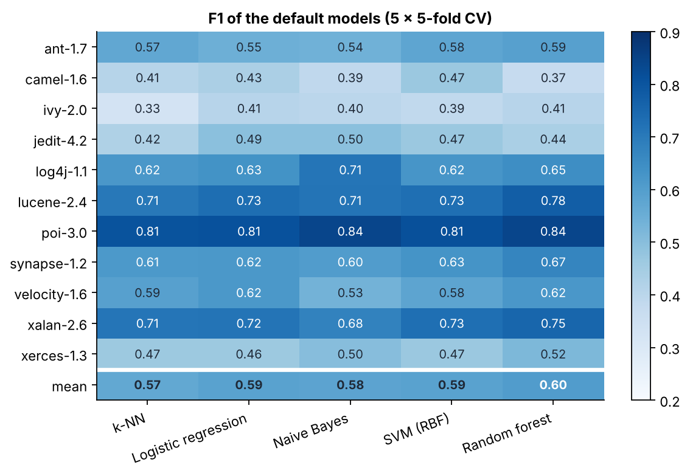
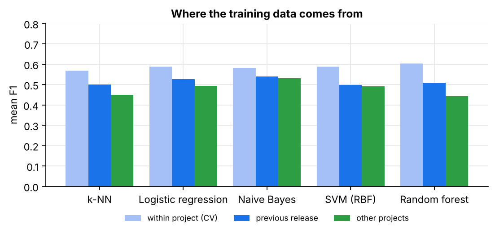

# BugPredictor: results

Generated by `python experiments/run_all.py` (raw numbers in `results/raw/`, tables in `results/tables/`).

## Data

One release per project from the PROMISE repository (20 CK/object-oriented metrics per Java class; a class is *defective* when at least one bug was linked to it). For each project, the latest release with 5 % to 70 % defective classes is used.

| Release | Classes | Defective | Share | Previous release (cross-version) |
|---|---:|---:|---:|---:|
| ant-1.7 | 745 | 166 | 22.3 % | ant-1.6 |
| camel-1.6 | 965 | 188 | 19.5 % | camel-1.4 |
| ivy-2.0 | 352 | 40 | 11.4 % | ivy-1.4 |
| jedit-4.2 | 367 | 48 | 13.1 % | jedit-4.1 |
| log4j-1.1 | 109 | 37 | 33.9 % | log4j-1.0 |
| lucene-2.4 | 340 | 203 | 59.7 % | lucene-2.2 |
| poi-3.0 | 442 | 281 | 63.6 % | poi-2.5 |
| synapse-1.2 | 256 | 86 | 33.6 % | synapse-1.1 |
| velocity-1.6 | 229 | 78 | 34.1 % | velocity-1.5 |
| xalan-2.6 | 885 | 411 | 46.4 % | xalan-2.5 |
| xerces-1.3 | 453 | 69 | 15.2 % | xerces-1.2 |

## 1. The leakage of the original protocol

The original notebooks standardised the data and applied SMOTE to the **whole dataset**, then ran cross-validation (and the GA) on the resampled rows. A synthetic class is an interpolation between a real class and one of its neighbours, so most test folds contain near-copies of training rows (and synthetic rows are themselves tested). The table re-runs both protocols on the same releases; F1 of the defective class.

| Release | 1-NN, SMOTE before CV | 1-NN, SMOTE in folds | 5-NN, before | 5-NN, in folds | GA, original protocol | GA, nested CV | Default 5-NN |
|---|---:|---:|---:|---:|---:|---:|---:|
| ant-1.7 | 0.885 | 0.532 | 0.855 | 0.561 | 0.894 | 0.574 | 0.575 |
| camel-1.6 | 0.862 | 0.354 | 0.811 | 0.406 | 0.878 | 0.369 | 0.394 |
| ivy-2.0 | 0.907 | 0.324 | 0.860 | 0.324 | 0.939 | 0.363 | 0.306 |
| jedit-4.2 | 0.932 | 0.457 | 0.881 | 0.403 | 0.948 | 0.429 | 0.388 |
| log4j-1.1 | 0.876 | 0.646 | 0.809 | 0.618 | 0.905 | 0.622 | 0.585 |
| lucene-2.4 | 0.769 | 0.741 | 0.692 | 0.686 | 0.777 | 0.689 | 0.709 |
| poi-3.0 | 0.834 | 0.821 | 0.771 | 0.778 | 0.854 | 0.828 | 0.812 |
| synapse-1.2 | 0.852 | 0.603 | 0.778 | 0.613 | 0.875 | 0.661 | 0.632 |
| velocity-1.6 | 0.813 | 0.579 | 0.764 | 0.603 | 0.857 | 0.582 | 0.577 |
| xalan-2.6 | 0.760 | 0.670 | 0.727 | 0.699 | 0.787 | 0.731 | 0.717 |
| xerces-1.3 | 0.919 | 0.482 | 0.881 | 0.488 | 0.924 | 0.508 | 0.463 |
| **mean** | **0.855** | **0.564** | **0.803** | **0.562** | **0.876** | **0.578** | **0.560** |

The original protocol reports a mean F1 of **0.876** for the GA-optimised k-NN; evaluated without leakage (nested cross-validation, SMOTE fitted inside each training fold) the same method reaches **0.578**. The 1-NN classifier, which the original GA kept choosing, shows the mechanism most clearly: 0.855 with SMOTE before the split, 0.564 with SMOTE inside the folds.

For reference, the result files stored by the original notebooks (`research/original/results/knn/`, release not recorded) report these best F1 scores: ant 0.938, camel 0.984, ivy 0.807, jedit 0.889, log4j 0.952, lucene 0.729, poi 0.831, tomcat 0.942, velocity 0.933, xalan 0.934.

## 2. Default models

Repeated stratified cross-validation (5 × 5 folds). In every fold, imputation, the log(1 + x) transform, standardisation and SMOTE are fitted on the training rows only. F1 ± standard deviation over the 25 folds:

| Release | k-NN | Logistic regression | Naive Bayes | SVM (RBF) | Random forest |
|---|---:|---:|---:|---:|---:|
| ant-1.7 | 0.570 ± 0.04 | 0.547 ± 0.05 | 0.540 ± 0.06 | 0.575 ± 0.05 | 0.594 ± 0.06 |
| camel-1.6 | 0.410 ± 0.04 | 0.433 ± 0.05 | 0.388 ± 0.04 | 0.467 ± 0.05 | 0.372 ± 0.05 |
| ivy-2.0 | 0.328 ± 0.09 | 0.405 ± 0.11 | 0.399 ± 0.08 | 0.386 ± 0.13 | 0.408 ± 0.13 |
| jedit-4.2 | 0.424 ± 0.06 | 0.493 ± 0.09 | 0.495 ± 0.06 | 0.467 ± 0.06 | 0.438 ± 0.07 |
| log4j-1.1 | 0.618 ± 0.10 | 0.632 ± 0.16 | 0.712 ± 0.11 | 0.625 ± 0.15 | 0.647 ± 0.15 |
| lucene-2.4 | 0.705 ± 0.06 | 0.732 ± 0.04 | 0.715 ± 0.05 | 0.729 ± 0.04 | 0.776 ± 0.04 |
| poi-3.0 | 0.806 ± 0.03 | 0.812 ± 0.03 | 0.842 ± 0.03 | 0.813 ± 0.03 | 0.841 ± 0.02 |
| synapse-1.2 | 0.614 ± 0.07 | 0.616 ± 0.07 | 0.604 ± 0.06 | 0.632 ± 0.09 | 0.669 ± 0.08 |
| velocity-1.6 | 0.592 ± 0.07 | 0.617 ± 0.09 | 0.534 ± 0.10 | 0.579 ± 0.06 | 0.620 ± 0.09 |
| xalan-2.6 | 0.714 ± 0.03 | 0.716 ± 0.03 | 0.678 ± 0.03 | 0.729 ± 0.03 | 0.753 ± 0.04 |
| xerces-1.3 | 0.465 ± 0.07 | 0.463 ± 0.06 | 0.503 ± 0.08 | 0.467 ± 0.06 | 0.520 ± 0.06 |

Mean over the 11 releases:

| Metric | k-NN | Logistic regression | Naive Bayes | SVM (RBF) | Random forest |
|---|---:|---:|---:|---:|---:|
| F1 | 0.568 | 0.588 | 0.583 | 0.588 | 0.603 |
| MCC | 0.371 | 0.404 | 0.392 | 0.408 | 0.441 |
| AUC | 0.774 | 0.799 | 0.786 | 0.796 | 0.820 |
| Recall@20%LOC | 0.444 | 0.464 | 0.372 | 0.464 | 0.469 |
| Precision | 0.512 | 0.541 | 0.520 | 0.558 | 0.613 |
| Recall | 0.695 | 0.691 | 0.723 | 0.660 | 0.608 |
| False-alarm rate | 0.280 | 0.245 | 0.280 | 0.219 | 0.167 |

*Recall@20%LOC*: share of the defective classes found when classes are inspected by decreasing predicted risk per line of code, until 20 % of the code has been read. The simple *smallest classes first* baseline (ManualUp) reaches **0.445** on the same releases.

## 3. Genetic algorithm, nested cross-validation

Outer loop: 5 stratified folds. On the training part of each outer fold, the GA (population 20, up to 15 generations, tournament selection, uniform crossover, elitism) searches a subset of the 20 metrics and the hyperparameters, scoring each individual by the mean F1 of an **inner** 5-fold cross-validation (minus 0.005 per metric kept). The chosen model is then retrained on the whole training part and scored on the outer test fold, which the search never saw. The default model is scored on the same folds.

### k-NN

| Release | F1 default | F1 GA | Δ F1 | MCC default | MCC GA | AUC default | AUC GA | Metrics kept | GA's inner-CV F1 |
|---|---:|---:|---:|---:|---:|---:|---:|---:|---:|
| ant-1.7 | 0.575 | 0.574 | -0.002 | 0.441 | 0.437 | 0.813 | 0.798 | 7.8 | 0.612 |
| camel-1.6 | 0.394 | 0.369 | -0.025 | 0.201 | 0.170 | 0.668 | 0.664 | 6.4 | 0.469 |
| ivy-2.0 | 0.306 | 0.363 | +0.057 | 0.201 | 0.287 | 0.724 | 0.754 | 7.2 | 0.509 |
| jedit-4.2 | 0.388 | 0.429 | +0.040 | 0.293 | 0.333 | 0.768 | 0.770 | 6.0 | 0.577 |
| log4j-1.1 | 0.585 | 0.622 | +0.037 | 0.332 | 0.434 | 0.783 | 0.776 | 7.0 | 0.785 |
| lucene-2.4 | 0.709 | 0.689 | -0.020 | 0.348 | 0.314 | 0.736 | 0.690 | 5.8 | 0.781 |
| poi-3.0 | 0.812 | 0.828 | +0.016 | 0.528 | 0.534 | 0.836 | 0.826 | 5.6 | 0.871 |
| synapse-1.2 | 0.632 | 0.661 | +0.029 | 0.415 | 0.474 | 0.764 | 0.780 | 8.2 | 0.728 |
| velocity-1.6 | 0.577 | 0.582 | +0.005 | 0.327 | 0.339 | 0.736 | 0.777 | 5.8 | 0.741 |
| xalan-2.6 | 0.717 | 0.731 | +0.013 | 0.476 | 0.502 | 0.812 | 0.823 | 5.8 | 0.765 |
| xerces-1.3 | 0.463 | 0.508 | +0.045 | 0.358 | 0.411 | 0.759 | 0.762 | 8.2 | 0.603 |
| **mean** | **0.560** | **0.578** | **+0.018** | 0.356 | 0.385 | 0.764 | 0.765 | 6.7 | 0.676 |

### SVM (RBF)

| Release | F1 default | F1 GA | Δ F1 | MCC default | MCC GA | AUC default | AUC GA | Metrics kept | GA's inner-CV F1 |
|---|---:|---:|---:|---:|---:|---:|---:|---:|---:|
| ant-1.7 | 0.568 | 0.584 | +0.016 | 0.434 | 0.450 | 0.801 | 0.812 | 5.2 | 0.616 |
| camel-1.6 | 0.458 | 0.407 | -0.051 | 0.302 | 0.221 | 0.736 | 0.699 | 7.4 | 0.477 |
| ivy-2.0 | 0.342 | 0.373 | +0.031 | 0.251 | 0.294 | 0.754 | 0.761 | 6.8 | 0.499 |
| jedit-4.2 | 0.453 | 0.452 | -0.002 | 0.375 | 0.365 | 0.825 | 0.841 | 6.0 | 0.579 |
| log4j-1.1 | 0.657 | 0.596 | -0.061 | 0.480 | 0.390 | 0.800 | 0.773 | 6.6 | 0.784 |
| lucene-2.4 | 0.744 | 0.741 | -0.003 | 0.405 | 0.250 | 0.766 | 0.670 | 6.2 | 0.795 |
| poi-3.0 | 0.810 | 0.813 | +0.003 | 0.541 | 0.459 | 0.853 | 0.815 | 5.2 | 0.862 |
| synapse-1.2 | 0.623 | 0.635 | +0.012 | 0.421 | 0.442 | 0.796 | 0.766 | 6.8 | 0.699 |
| velocity-1.6 | 0.609 | 0.604 | -0.005 | 0.396 | 0.383 | 0.784 | 0.746 | 5.6 | 0.720 |
| xalan-2.6 | 0.720 | 0.726 | +0.006 | 0.492 | 0.478 | 0.832 | 0.799 | 5.2 | 0.748 |
| xerces-1.3 | 0.443 | 0.385 | -0.058 | 0.330 | 0.261 | 0.777 | 0.654 | 7.4 | 0.590 |
| **mean** | **0.584** | **0.574** | **-0.010** | 0.402 | 0.363 | 0.793 | 0.758 | 6.2 | 0.670 |

### Logistic regression

| Release | F1 default | F1 GA | Δ F1 | MCC default | MCC GA | AUC default | AUC GA | Metrics kept | GA's inner-CV F1 |
|---|---:|---:|---:|---:|---:|---:|---:|---:|---:|
| ant-1.7 | 0.542 | 0.567 | +0.025 | 0.393 | 0.425 | 0.800 | 0.823 | 3.6 | 0.597 |
| camel-1.6 | 0.441 | 0.409 | -0.031 | 0.274 | 0.225 | 0.730 | 0.706 | 8.0 | 0.461 |
| ivy-2.0 | 0.344 | 0.340 | -0.005 | 0.257 | 0.251 | 0.788 | 0.779 | 5.4 | 0.458 |
| jedit-4.2 | 0.528 | 0.480 | -0.048 | 0.465 | 0.408 | 0.857 | 0.841 | 6.8 | 0.581 |
| log4j-1.1 | 0.617 | 0.612 | -0.005 | 0.422 | 0.403 | 0.810 | 0.770 | 6.0 | 0.763 |
| lucene-2.4 | 0.733 | 0.719 | -0.014 | 0.390 | 0.368 | 0.775 | 0.739 | 6.2 | 0.773 |
| poi-3.0 | 0.808 | 0.805 | -0.003 | 0.526 | 0.488 | 0.846 | 0.791 | 4.8 | 0.850 |
| synapse-1.2 | 0.594 | 0.628 | +0.034 | 0.378 | 0.417 | 0.784 | 0.778 | 6.0 | 0.682 |
| velocity-1.6 | 0.610 | 0.588 | -0.022 | 0.417 | 0.383 | 0.807 | 0.771 | 7.6 | 0.718 |
| xalan-2.6 | 0.722 | 0.731 | +0.010 | 0.481 | 0.475 | 0.821 | 0.812 | 4.0 | 0.743 |
| xerces-1.3 | 0.446 | 0.471 | +0.025 | 0.331 | 0.372 | 0.774 | 0.785 | 6.6 | 0.527 |
| **mean** | **0.581** | **0.577** | **-0.003** | 0.394 | 0.383 | 0.799 | 0.781 | 5.9 | 0.650 |

### Summary

| Model | F1 default | F1 GA | Δ F1 | GA better on | Metrics kept | GA's own estimate (inner CV) |
|---|---:|---:|---:|---:|---:|---:|
| k-NN | 0.560 | 0.578 | +0.018 | 8 / 11 | 6.7 / 20 | 0.676 |
| SVM (RBF) | 0.584 | 0.574 | -0.010 | 5 / 11 | 6.2 / 20 | 0.670 |
| Logistic regression | 0.581 | 0.577 | -0.003 | 4 / 11 | 5.9 / 20 | 0.650 |

The last column is the F1 the GA *believed* it had reached, measured on the folds it was optimising; the gap with the outer test score is the optimism that a non-nested protocol would have reported as a result.

## 4. Which metrics does the GA keep?

Over 165 GA runs (3 models × 11 releases × 5 outer folds), the most often selected metrics are `rfc` (41 %), `loc` (36 %), `dit` (35 %), `ce` (35 %), `cbm` (35 %), `cbo` (34 %); the least often `ca` (27 %), `ic` (26 %), `mfa` (25 %), `moa` (24 %).

## 5. Preprocessing choices

Mean over the 11 releases, 3 × 5-fold CV. Each variant removes one step of the pipeline.

| Model | F1 full pipeline | F1 without log | F1 without SMOTE | Recall full | Recall without SMOTE |
|---|---:|---:|---:|---:|---:|
| k-NN | 0.563 | 0.559 | 0.541 | 0.690 | 0.496 |
| Logistic regression | 0.587 | 0.577 | 0.529 | 0.688 | 0.476 |
| Naive Bayes | 0.581 | 0.505 | 0.585 | 0.720 | 0.674 |
| SVM (RBF) | 0.586 | 0.567 | 0.497 | 0.656 | 0.430 |

## 6. Predicting a new release, or a new project

*Cross-version*: train on the previous release of the same project, test on the release above (the realistic use: learn from the last release, predict the next one). *Cross-project*: train on the 10 other releases pooled, test on this one. Mean over the 11 releases:

| Model | F1 within (CV) | F1 cross-version | F1 cross-project | AUC within | AUC cross-version | AUC cross-project |
|---|---:|---:|---:|---:|---:|---:|
| k-NN | 0.568 | 0.501 | 0.450 | 0.774 | 0.683 | 0.648 |
| Logistic regression | 0.588 | 0.527 | 0.495 | 0.799 | 0.719 | 0.725 |
| Naive Bayes | 0.583 | 0.540 | 0.532 | 0.786 | 0.742 | 0.756 |
| SVM (RBF) | 0.588 | 0.498 | 0.492 | 0.796 | 0.707 | 0.715 |
| Random forest | 0.603 | 0.509 | 0.444 | 0.820 | 0.704 | 0.726 |

